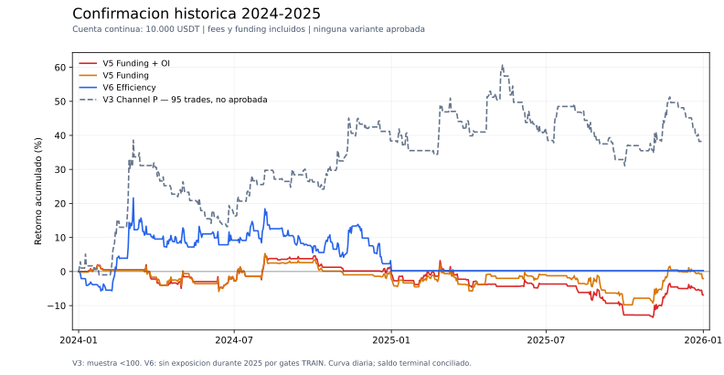

# Cierre consolidado de investigación V1–V6

Fecha local: 20 de octubre de 2026. **Ninguna candidata aprobada; objetivo de 20–30% anual no alcanzado.** Trabajo económico y técnico requerido completo. Auditoría independiente económica final global PASS, sin discrepancias materiales.

## Alcance completado

| Ciclo | Backtests económicos nuevos | Slots nominales con reusos | Resultado |
|---|---:|---:|---|
| V1 |96|96|Sin candidata|
| V2 |16|32|Sin candidata|
| V3 |33|36|Avance parcial individual CHANNEL_P; sin aprobación|
| V4 |6|6|Seis screenings negativos|
| V5 |37|40|Dos finalistas de funding, ambas rechazadas tras confirmación y robustez completas|
| V6 |21|23|Efficiency P rechazada tras confirmación y robustez completas|
| Total |**209**|**233**|**24 slots reutilizados; ninguna promoción**|

V5/V6 aportan **58 backtests económicos nuevos y seis smokes técnicos: 64 sesiones nuevas únicas, todas finished**. Se verificaron 58 snapshots financieros completos. Hubo 23 intentos técnicos acumulados entre V1–V6, separados de la economía. Los 209 backtests no representan 209 muestras independientes: comparten datos, señales, períodos y variantes de reglas.

V5 consumió 40/40slots: 37 nuevos y 3 reusos. V6 usó 23/40: 21 nuevos y 2 reusos; 17 slots no utilizados por existir una sola finalista. No se rellenaron con tuning. RESEARCH_COUNTS_V1_V6_20261020.json y los inventarios finales contienen la contabilidad.

## Resultados nuevos en cuenta continua, 2024–2025

Capital inicial de 10000 USDT,2024-01-01→2026-01-01,731 días. Fee nominal 0,00045,slip 0,funding histórico,aislado 3x con notional máximo 1x y riesgo 2% incluyendo ambos fees.

| Variante | Neto total | CAGR 365/731 | PF | DD del motor | Trades | Semestres positivos |
|---|---:|---:|---:|---:|---:|---:|
| [V5 Funding+OI](http://localhost:9200/#/backtest/46f4c14a-1ac2-4cc0-b347-5d6bff007051) |−6,8665%|−3,4896%|0,8539|17,6693%|84|1/4|
| [V5 Funding](http://localhost:9200/#/backtest/ff2f12bf-1faf-4bec-808f-800a778421a4) |−2,0796%|−1,0438%|0,9606|14,3116%|107|2/4|
| [V6 Efficiency P](http://localhost:9200/#/backtest/f6f075f2-e7da-4f7b-ba2b-937456d5d127) |+0,2786%|+0,1390%|1,0062|17,5536%|44|1/4|

Nominal exige neto>0/PF≥1,2/DD≤25/N≥100/3 de 4 semestres positivos/CAGR≥15%. No se relajó ninguno. La meta orientativa 20–30% tampoco se alcanza.

V5: ambas finalistas habilitadas por TRAIN en los cuatro semestres; el selector global eligió OI siempre. Las evaluaciones independientes no reemplazan el replay:OI suma 83 trades en sesiones reseteadas y 84 en continuo. La extra: short 2025-01-01 04:00 UTC usa referencia OI previa válida, ausente en C3V independiente por inicio/no-backfill. No es una consulta futura.

V6: TRAIN C1/C2 habilitados; C3 rechazado por PF 1,1803 y C4 por PF 1,0649/DD31,4945. Replay activo sólo 2024 H1/H2 separados,2025 sin exposición y sin reset de capital. C4 diagnóstico ganó 7,7324%, pero se conserva OFF porque la decisión previa ya estaba fijada. Sus 46 trades diagnósticos inactivos no aumentan N44.

## Robustez completada, sin rescates

Se ejecutaron25motores de fase C: 17 V5 y 8 V6 (27 slots contando dos lags sin OI reutilizados). Todos mantuvieron calendario original. S1: fee0,0009/slip 0; S2: fee0,00045 / slip 5 bps informativo; S3: fee0,0009 / slip 10 bps. Cuatro vecinos por variante y lag OI 4h. Sizing,fees,fills/slippage ycapital se recalculan; no haircut contable.

- V5: ambos nominales, los seis costes, los ocho vecinos y lag OI terminaron negativos. Robustez requerida rechazada.
- V6: S1−1,9203%; S3−7,8957%; R09/R11/A11 negativos. A09 (umbral 0,315) ganó 10,3288% y pasó neto/DD, pero no reemplaza al nominal; CAGR 5,0304%/N50 tampoco acreditan los requisitos. Robustez conjunta rechazada.
- Sensibilidades proxy/globalfunding ×0,5/1,5 y concentración son descriptivas con cantidades originales, no estrategias ni nuevos motores.

## Evidencia parcial histórica más cercana

[Replay individual V3 CHANNEL_P](http://localhost:9200/#/backtest/16da36e2-2807-4a9b-85e3-51cf8fa67c75): neto+38,2259%,CAGR 17,5435%,PF 1,3485,DD 18,4140%,95 operaciones y 3/4 semestres positivos. Sigue sin aprobar el mínimo N100 y queda debajo de 20–30% anual. No se buscan cinco operaciones para aprobarlo.

Sus costes y vecinos requeridos conservaron neto positivo/DD≤25, pero el vecino de riesgo 0,9 redujo el CAGR a ~4,31%: sensibilidad material. 2024+38,3503% y 2025−0,0899%; resultado concentrado en 2024.

CHANNEL_P era finalista individual prerregistrada. El selector global V3 eligió CHANNEL_POI en los cuatro folds; [su replay](http://localhost:9200/#/backtest/48ee9577-29cb-4860-8dff-be0d82caf796) tuvo CAGR 10,8403%,N84 y fragilidad de costes. No se sustituye esa política retrospectivamente por P.

## Línea elegible que quedó sin confirmar

V5 CROSS_P/POI pasaron SCREEN, pero el ranking de menor DD y cap máximo 2 seleccionó las dos Funding. CROSS_P tenía CAGR de desarrollo 21,3292%/PF 1,7118/DD17,6955%. **No se afirma que CROSS falló 2024–2025: esa confirmación no se realizó.** Su dato de entrenamiento tampoco autoriza promoción. No se cambió el ranking al observar pérdidas Funding ni se añadió otro ensayo fuera del protocolo.

## Trazabilidad y límites

Tres subagentes dedicados por ciclo, propietario por sector nuevo, máximo global de dos motores y dos análisis. Al final,V5 aprovechó los dos motores liberados de V6; ningún agente excedió dos. Fuentes y config se congelaron antes de economía; selecciones train antes de evaluación; calendarios antes de replay.

67 fuentes nuevas verificados byte a byte (30 core/sectores, 21 WF, 16 replay),más dependencia V2congelada.750 checks iniciales y 1608 de replays,además de los wrappers WF;smokes separados.58 accountings completos PASS: errores máximos V5=3,64e−11/V6=2,91e−11 USDT frente a tolerancia 1e−6. Logs yplanes se auditan por separado porque los snapshots no los incluyen. Pruebas estáticas no prueban fills de broker o ramas que un motor no ejercitó.

**2026 permanece cerrado**:finish 2026-01-01 excluye velas/funding de ese año. El cierre en ese timestamp usa la última vela 2025. Sin ML/live/paper/cuentas/Pi,instalaciones,restarts o cambios de framework. Timeouts se recuperaron por lectura del mismo ID,sin repetir start. Todas las corridas requeridas terminaron;no hay motores activos de esta investigación.

2024–2025 ya fue examinado en ciclos anteriores. Los replays son confirmación histórica adaptativa, no una muestra prospectiva virgen ni evidencia de rentabilidad futura. El objetivo económico permanece no logrado aunque el trabajo del alcance autorizado esté completo.

## Informes

FINAL_DECISION_V5.md;FINAL_DECISION_V6.md;REGISTRY_V5.json;REGISTRY_V6.json;V5_FINAL_ACCOUNTING_INDEX.json;V6_FINAL_ACCOUNTING_INDEX.json;V5_FINAL_SESSION_INVENTORY.json;V6_FINAL_SESSION_INVENTORY.json;V5_V6_WF_CALENDAR_FINAL_INDEPENDENT_AUDIT.md;V5_V6_FINAL_ECONOMIC_INDEPENDENT_AUDIT.md;RESEARCH_WALK_FORWARD_HANDOFF_FINAL_V6_20261020.md.

Los informes y artefactos están guardados en strategies/FundingOiPilot4h/reports/ dentro del proyecto Jesse.
